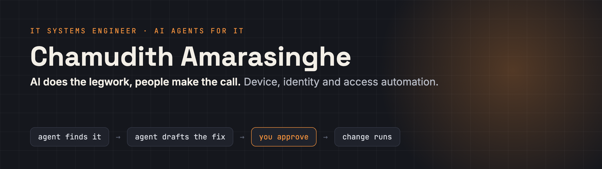
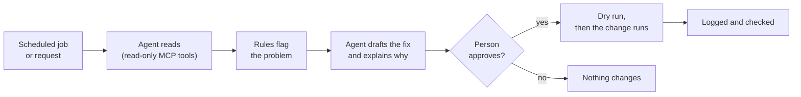
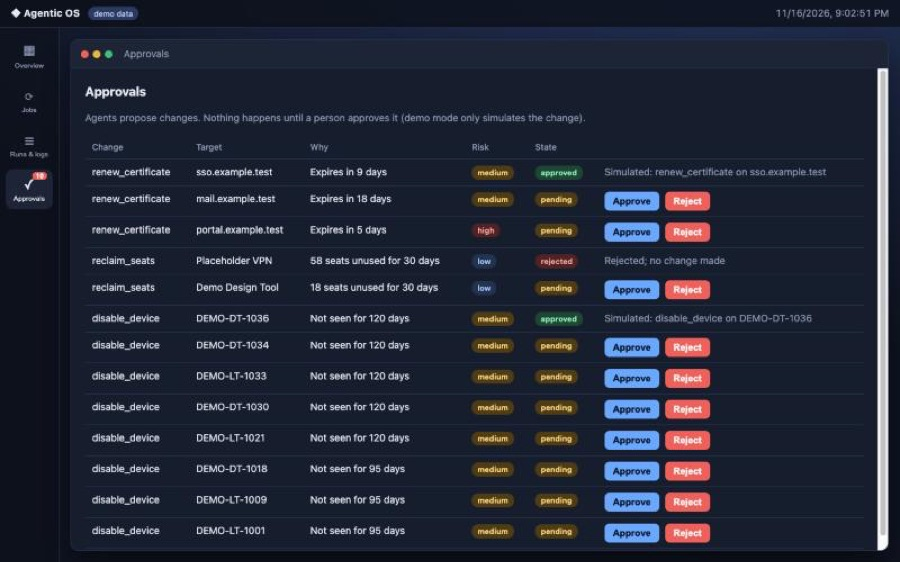
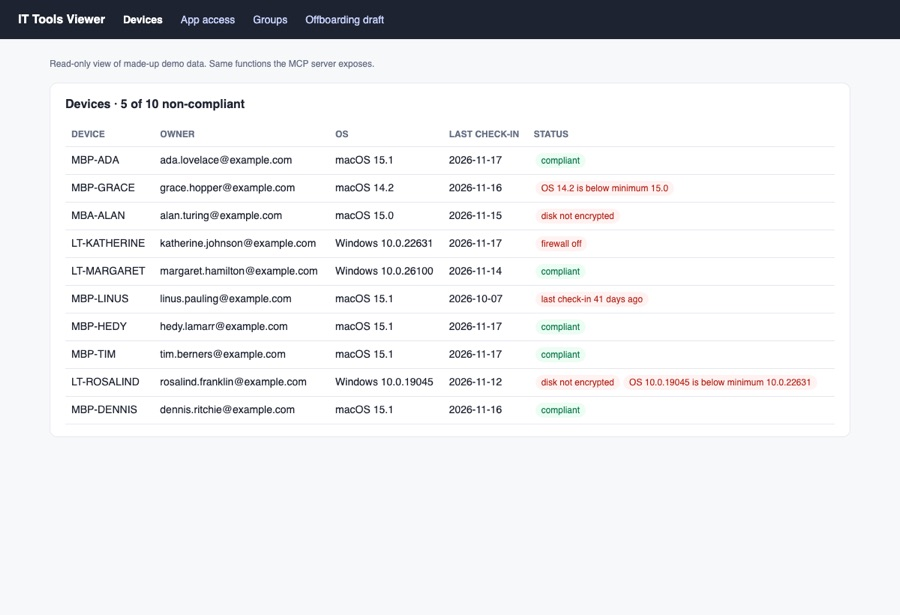
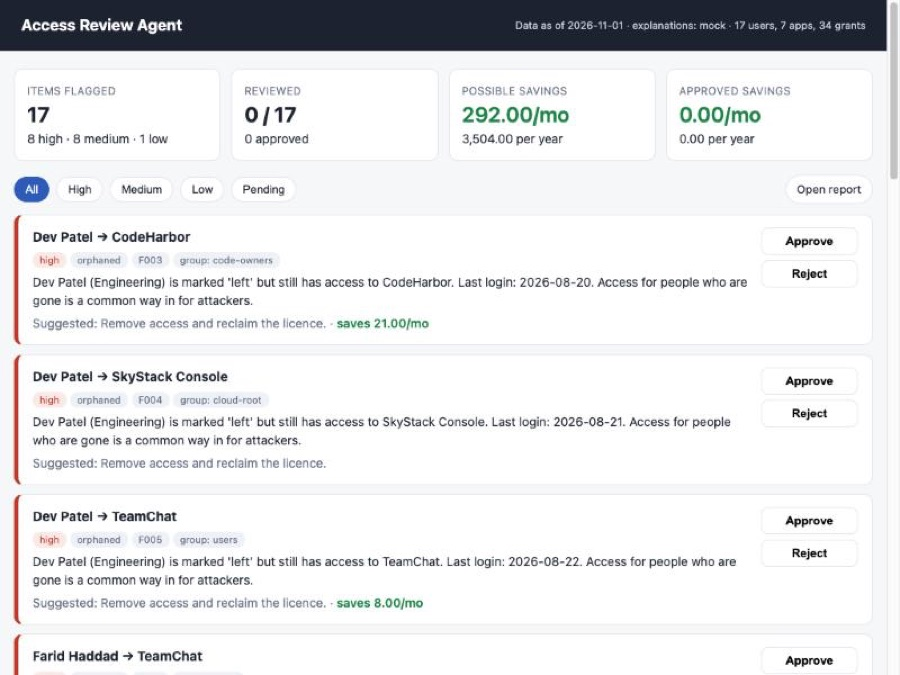
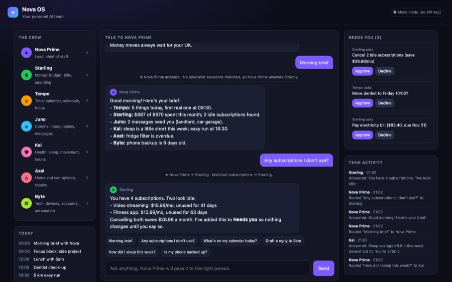
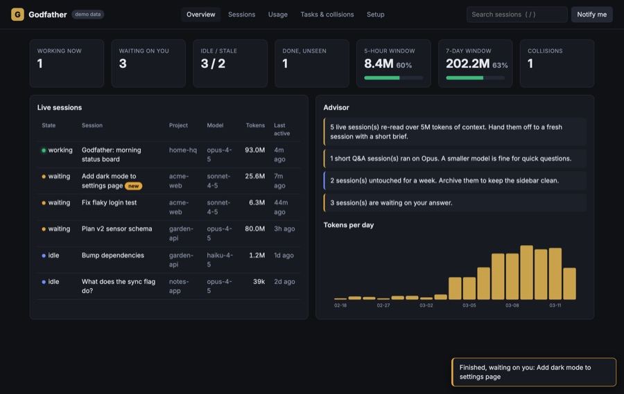
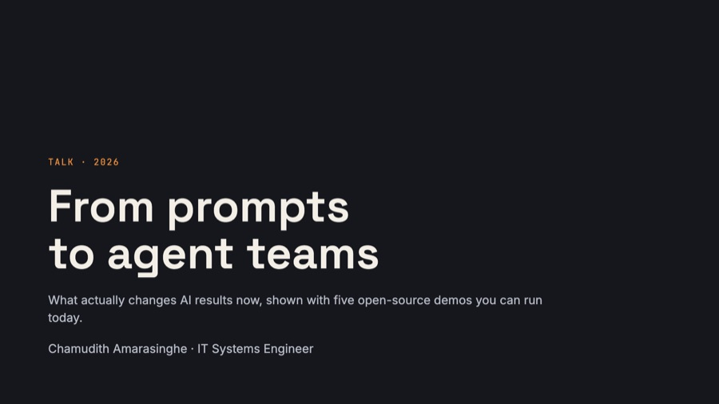

I'm an IT systems engineer who builds **AI agents for device, identity and access work**. They find the problem, draft the fix and wait for a person to approve it. Nothing changes without a human, and everything is dry-run first.

**9 years in IT**, from desk-side support to systems engineering, running Mac, Windows and iOS fleets of **1,000+ devices** in regulated industries.

## ⚡ Highlights

| Result | What it means |
|---|---|
| **< 30 min** | New-device setup with zero-touch Jamf, Intune and Automox, down from between 8 hours and 2 days |
| **5 open-source demos** | Agentic IT tools you can clone and run on made-up data, most with no API key |
| **1 talk** | [From Prompts to Agent Teams](https://github.com/chamu262/presentations/tree/main/2026%20-%20From%20Prompts%20to%20Agent%20Teams): six practices that change AI results now |

## 🧭 How I build agents

## 🧰 Projects

<table>
<tr>
<td width="33%" valign="top"> <b><a href="https://github.com/chamu262/agentic-os-demo">agentic-os-demo</a></b> Scheduled IT jobs where agents propose changes and a person approves each one.</td>
<td width="33%" valign="top"> <b><a href="https://github.com/chamu262/poc.mcp-it-tools">poc.mcp-it-tools</a></b> An MCP server that gives AI agents safe, read-only IT tools: devices, users, groups, access.</td>
<td width="33%" valign="top"> <b><a href="https://github.com/chamu262/sample-agentic-access-review">sample-agentic-access-review</a></b> Rules flag unused or risky access, AI explains each flag, a person approves.</td>
</tr>
<tr>
<td width="33%" valign="top"> <b><a href="https://github.com/chamu262/nova-os-demo">nova-os-demo</a></b> A personal AI team: a lead agent routes each request to the right specialist.</td>
<td width="33%" valign="top"> <b><a href="https://github.com/chamu262/godfather">godfather</a></b> A supervisor setup for Claude Code: sessions, skills, memory and a live dashboard.</td>
<td width="33%" valign="top"> <b><a href="https://github.com/chamu262/presentations">presentations</a></b> Slides and speaker notes, each practice linked to a runnable demo.</td>
</tr>
</table>

## 🔭 What I do

*   **Agentic IT operations:** scheduled jobs that propose changes, with approval gates and dry runs.
*   **AI connected to IT systems** through read-only MCP tools for devices, users, groups and access.
*   **AI-assisted access reviews:** rules flag leavers, unused admin rights and idle paid seats; the agent explains each flag.
*   **Zero-touch deployment** with Jamf, Intune and Automox, plus staged rollouts gated by conditional access and compliance.
*   **Migrations end to end:** MDM platforms, and VPN from Tailscale to NetBird.
*   **Automations and SSO:** jobs on Google Cloud Run, SSO and SAML app integrations.
*   **Claude Code as a team:** a supervisor session, project masters, skills, memory and approval gates.

## 💻 Tech stack

**AI & agents** 

**Endpoint & identity** 

**Languages** 

**Cloud & network** 

## 🎓 Education & certifications

*   **BS Mathematics and Computer Science** (double major), CUNY College of Staten Island, 2021 · Dean's List
*   **Certifications:**  

## 📫 Let's talk

I'm looking for my next role in AI automation, IT systems, identity/IAM or forward-deployed engineering. The fastest way to reach me is [LinkedIn](https://www.linkedin.com/in/chamudith-amarasinghe-ab1223216).
